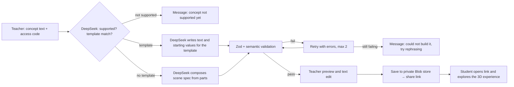

# ConceptLab

Type a concept, get an interactive 3D learning experience. ConceptLab is an AI-powered
tool for teachers: you describe a concept that depends on spatial or moving
relationships — *why seasons happen*, *why the Moon has phases* — and ConceptLab turns it
into an interactive Three.js scene students can explore from a share link, with no
accounts and nothing collected from students.

**Standard:** NGSS MS-ESS1-1 — "Develop and use a model of the Earth-sun-moon system to
describe the cyclic patterns of lunar phases, eclipses of the sun and moon, and seasons."
The first version covers the Earth–Sun–Moon system, with common misconceptions (see
[*A Private Universe*](https://www.youtube.com/watch?v=JbUm3iaVQ_o), Harvard-Smithsonian,
1987) deliberately testable through the "Try this" prompts.

## What it does

- A teacher types a concept plus an access code on `/create`. DeepSeek (see the data note
  below) turns it into a **declarative scene spec** — never code.
- **Hybrid generation:** DeepSeek first picks a hand-built template when one matches
  (v1 has one: **Seasons**). Otherwise it composes a scene from a small library of parts
  (sphere, light source, orbit path, arrow, label, ground patch) bound to sliders through
  whitelisted operations, with readouts computed from real astronomy formulas.
- Concepts outside what the parts library can show get "This concept isn't supported yet"
  and nothing is generated.
- The teacher previews, can edit every text field (re-validated), and saves — which
  creates a share link `/e/<shareId>`.
- `/demo` shows both reference experiences (Seasons template, Moon phases composed) with
  no setup, no AI calls and no storage.

## Accuracy over spectacle

- Readouts use real formulas: solar declination, noon sun altitude, geometric daylight
  hours (clamped 0–24 h for polar day/night), beam spread 1/sin(altitude), the
  Earth–Sun ellipse (perihelion in early January), Moon elongation and illuminated
  fraction (1 − cos E)/2.
- Scenes show a **"Not to scale"** badge; compressed time is labelled **"Time-lapse"**.
- The Seasons experience makes the classic misconception testable: Earth is closest to
  the Sun in **January**, not summer. The Moon phases experience lets students check that
  Earth's shadow is not what causes phases.

## Architecture



DeepSeek never writes code. It outputs a declarative scene spec (Zod-validated, semantic
checks on part types, binding targets, slider ranges and formula names) and the app
renders that spec. All model output is re-validated server-side; empty or cut-off replies
count as validation failures and trigger retries (max 2).

## Modes

| Mode | When it applies | Generation |
|---|---|---|
| **Live** | `FIXTURE_MODE` is not `true` and `DEEPSEEK_API_KEY` is set | DeepSeek |
| **Fixture** | `FIXTURE_MODE=true` or `DEEPSEEK_API_KEY` is missing | Recorded output from fixture files |

`.env.example` ships with `FIXTURE_MODE=true`. On Vercel, Preview deployments run with
`FIXTURE_MODE=true` and Production with `FIXTURE_MODE=false`.

In Fixture mode, concept text containing "season" returns the Seasons fixture, text
containing "moon" and "phase" returns the Moon phases fixture; anything else shows
"Fixture mode: only the sample concepts are available". `/demo` always uses pre-made
experiences bundled with the app and never reads or writes storage.

## Storage

There is no database. Two kinds of small JSON documents live in a **private Vercel Blob
store**:

- `<env>/experiences/<shareId>.json` — `{ shareId, concept, spec, createdAt }`, written
  once with `allowOverwrite: false` (experiences are never edited or deleted by the app).
- `<env>/usage/<YYYY-MM-DD>.json` — `{ date, calls, inputTokens, outputTokens }`, UTC
  dates.

`<env>` is `production`, `preview` or `development` (from `VERCEL_ENV`), so environments
never mix. The daily counter uses optimistic concurrency: read the ETag with `head()`,
write with `ifMatch`, retry up to 5 times on `BlobPreconditionFailedError`.

Three implementations sit behind one repository interface for experiences and one for
usage:

- **Blob** — whenever Blob credentials are present (on Vercel, or locally after
  `vercel env pull`).
- **Local files** — local development without Blob credentials; files in `.data/`
  (git-ignored).
- **In-memory** — automated tests only.

SQLite was considered and rejected: Vercel functions have no persistent disk
([reference](https://vercel.com/guides/is-sqlite-supported-in-vercel)). Private Blob
storage is built into Vercel and needs no extra account
([reference](https://vercel.com/docs/vercel-blob/private-storage)).

## Safeguards

- **Generation access:** creating an experience requires `LIVE_AI_ACCESS_CODE` (Live and
  Fixture mode). Share links and `/demo` need no code. Share IDs are 12 random URL-safe
  characters from a 59-character alphabet and the server accepts only that format.
- **AI spending:** `AI_DAILY_CAP` (default 150 calls/day ≈ 50 generations; one generation
  uses 2–4 calls). The counter is checked before each call and updated after it.
- **Storage:** the Blob store is private; only server code touches it. Share pages load
  the experience on the server and never expose Blob URLs or tokens to the browser.
- **Untrusted text:** concept text and generated/edited text are rendered as plain text,
  never HTML. In prompts the concept is wrapped as data and the system prompt says not to
  follow instructions inside it.
- **DeepSeek data location:** DeepSeek processes data on servers in China. This is stated
  on the create page and here.

## Setup

Requirements: Node 24, npm.

```sh
npm install
cp .env.example .env.local   # then fill in the values (see below)
npm run dev                  # http://localhost:3000
```

Checks:

```sh
npm run lint        # ESLint
npm run typecheck   # tsc --noEmit
npm test            # Vitest unit tests (includes live Blob contract tests when
                    # BLOB_READ_WRITE_TOKEN is present; skipped and reported as
                    # skipped otherwise)
npm run test:e2e    # Playwright, fixture mode, starts/stops its own dev server
```

## Environment variables

Copy `.env.example` to `.env.local` and fill in:

| Variable | Meaning |
|---|---|
| `DEEPSEEK_API_KEY` | DeepSeek hosted API key with credit. Empty ⇒ Fixture mode. |
| `DEEPSEEK_MODEL` | Model name (read from this variable, never hardcoded). |
| `LIVE_AI_ACCESS_CODE` | Code teachers must enter to create experiences. |
| `AI_DAILY_CAP` | Max DeepSeek calls per day (default 150). |
| `FIXTURE_MODE` | `true` ⇒ recorded fixtures, no AI calls. |

`BLOB_READ_WRITE_TOKEN` is written by the Vercel CLI (`vercel blob create-store` /
`vercel env pull`); with it present, storage goes to Blob, without it to `.data/`.

## Asset licences

- Earth texture: **NASA Blue Marble** (`public/textures/earth-blue-marble.jpg`,
  via the three.js example assets; NASA imagery is in the public domain —
  credit: NASA/Goddard Space Flight Center Earth Observatory,
  https://visibleearth.nasa.gov/collection/1484/blue-marble). Recorded here per the plan's
  requirement to keep credit and licence with the asset.

## Agent notes

Progress log: `docs/PROGRESS.md`. Blockers and owner actions: `docs/BLOCKERS.md`.
The implementation plan (`conceptlab-implementation-plan.md`) is the source of truth.
