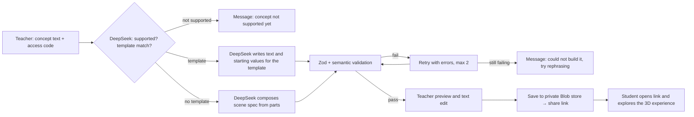

# ConceptLab – Implementation Plan

## Problem Statement
Some concepts are hard to explain with words or static diagrams, because they depend on spatial or moving relationships, such as why seasons happen or why the Moon has phases. ConceptLab is an AI-powered tool that lets a teacher type such a concept and get an interactive 3D learning experience built with Three.js. The teacher saves it and shares a link with students, who explore it in their browser.

## Goals
- **Portfolio:** a public GitHub repo (`iwyusdaz/conceptlab`) and a live Vercel site.
- **Personal tool:** usable with real classes through share links.

## Starting Point
- `/Users/iwayanusada/conceptlab` exists and contains only this plan file.
- There is no `conceptlab` repo on GitHub yet. The agent creates it.
- There is no `conceptlab` project on Vercel yet. The agent creates it.
- The GitHub CLI is logged in as `iwyusdaz`. The Vercel CLI is logged in as `iwyusd`.

## Requirements
- A teacher types a concept. DeepSeek turns it into an interactive 3D experience. This is the only use of AI in the project.
- Hybrid generation: DeepSeek picks a hand-built template when one matches. Otherwise it composes a scene from a library of parts.
- Version 1 covers concepts about the Earth–Sun–Moon system. It has one hand-built template (Seasons), and its parts library and formulas cover that system. The two reference concepts are Seasons (template) and Moon phases (composed).
- If a concept is outside what the parts library can show, the teacher sees "This concept isn't supported yet" and nothing is generated.
- Each experience has a 3D scene, controls (sliders), live readouts, a short explanation, and "Try this" prompts that guide students through the controls.
- The teacher previews the experience, can edit its text, and saves it. Saving creates a share link.
- Students open the share link and explore. Nothing is collected from students, and they need no account.
- No accounts for anyone.
- AI provider: DeepSeek hosted API (OpenAI-compatible). The key and model name come from environment variables.
- Stack: Next.js (App Router), React Three Fiber, TypeScript and Zod, deployed as the Vercel project `conceptlab`.
- Storage: a private Vercel Blob store. There is no database.
- Accuracy over spectacle: real astronomy formulas, "Not to scale" labels, and sped-up motion labelled "time-lapse".
- A `/demo` page shows pre-made example experiences with no API key and no AI cost.

## Learning Foundations
- **Standard:** NGSS MS-ESS1-1, "Develop and use a model of the Earth-sun-moon system to describe the cyclic patterns of lunar phases, eclipses of the sun and moon, and seasons."
- **Common misconceptions** (from *A Private Universe*, Harvard-Smithsonian, 1987): "distance from the Sun causes seasons" and "Earth's shadow causes Moon phases". The Seasons and Moon phases experiences include "Try this" prompts that let students test these ideas against the scene.

## Storage Design
ConceptLab stores two kinds of data, and both are small JSON documents:
- **Experiences:** written once when saved, then only read. They are never edited or deleted by the app.
- **Daily AI call counter:** one small document per day.

A database isn't needed for this. A private Vercel Blob store fits it, because Blob is built into Vercel, is created from the Vercel CLI, and needs no extra account or keys. SQLite was considered and rejected: Vercel functions have no persistent disk, so a SQLite file would lose its data. References: https://vercel.com/guides/is-sqlite-supported-in-vercel and https://vercel.com/docs/vercel-blob/private-storage

**Blob paths** (`<env>` is `production`, `preview` or `development`, from `VERCEL_ENV`, so environments never mix):
- `<env>/experiences/<shareId>.json`: `{ shareId, concept, spec, createdAt }`. Written with `allowOverwrite: false`.
- `<env>/usage/<YYYY-MM-DD>.json`: `{ date, calls, inputTokens, outputTokens }`, using UTC dates.

**Daily counter update:** read the day's document with `useCache: false`, add the new call, and write it back with `ifMatch` set to the ETag that was read. If the write fails with `BlobPreconditionFailedError`, read again and retry, up to 5 times. This keeps the count correct when two calls happen at the same time.

**Storage implementations,** behind one repository interface for experiences and one for usage:
- **Blob:** used whenever Blob credentials are present (on Vercel, or locally after `vercel env pull`).
- **Local files:** used in local development when there are no Blob credentials. Files go in `.data/`, which is in `.gitignore`.
- **In-memory:** used in automated tests only.

## Modes
| Mode | When it applies | Generation |
|---|---|---|
| **Live** | `FIXTURE_MODE` is not `true` and `DEEPSEEK_API_KEY` is set | DeepSeek |
| **Fixture** | `FIXTURE_MODE=true` or `DEEPSEEK_API_KEY` is missing | Recorded output from fixture files |

- `.env.example` sets `FIXTURE_MODE=true`. On Vercel, Preview deployments set `FIXTURE_MODE=true` and Production sets `FIXTURE_MODE=false`.
- In Fixture mode, concept text containing "season" returns the Seasons fixture and text containing "moon" and "phase" returns the Moon phases fixture. Any other text shows "Fixture mode: only the sample concepts are available".
- `/demo` always uses pre-made experiences bundled with the app, in every mode, and never reads or writes storage.

## Safeguards
- **Generation access:** creating an experience requires `LIVE_AI_ACCESS_CODE`, in both Live and Fixture mode. The owner shares this code only with teachers they choose. Opening a share link or `/demo` needs no code.
- **AI spending:** `AI_DAILY_CAP` limits DeepSeek calls per day. One generation uses 2 to 4 calls (match, build, up to 2 retries). The daily counter is checked before each call and updated after it.
- **Storage access:** the Blob store is private. Only server code reads and writes it. The share page loads the experience on the server and never exposes Blob URLs or tokens to the browser.
- **Share links:** use a random ID of 12 URL-safe characters, so links can't be guessed. The server accepts only IDs matching that format.
- **Untrusted text:** concept text and all generated or edited text are rendered as plain text, never as HTML. In the prompt, the concept text is wrapped as data and the system prompt says not to follow instructions inside it.
- **DeepSeek data location:** DeepSeek processes data on servers in China. The README and the create page state that concept text is sent to DeepSeek.

## Default Values
Environment variables can be overridden in `.env.local` or Vercel. All other values are constants in one config file.

| Setting | Default |
|---|---|
| `AI_DAILY_CAP` | 150 DeepSeek calls per day (about 50 generations) |
| Concept text limit | 500 characters |
| Editable text limit | 500 characters per field |
| Generation timeout | 60 seconds per DeepSeek call |
| Generation retries | 2 |
| Scene part cap | 40 parts per spec |
| Share ID | 12 characters, URL-safe random |
| Counter write retries | 5 |
| Frame rate | 30 fps or more on a mid-range laptop |
| Lighthouse (landing page) | Performance 90+, accessibility 95+ |
| Earth texture | NASA Blue Marble, compressed, with credit and licence recorded in the README |

## Technical Notes
- DeepSeek JSON Output (`response_format: {type: "json_object"}`) guarantees valid JSON but not a schema. All output goes through Zod and semantic checks. Empty or cut-off replies count as validation failures. Reference: https://api-docs.deepseek.com/guides/json_mode
- The DeepSeek model is read from `DEEPSEEK_MODEL`, never hardcoded.
- DeepSeek never writes code. It outputs a declarative scene spec that uses only whitelisted part types, binding operations and named formulas. The app renders that spec.
- Vercel Blob private storage needs `@vercel/blob` 2.3 or later. On Vercel, the SDK authenticates automatically once the store is connected to the project. Locally, it uses the credentials written by `vercel env pull`.
- Environment files: the owner writes `.env.local`. The agent pulls Vercel's variables into `.env.development.local`, so the owner's file is never overwritten. Both files match `.env*.local` in `.gitignore`.

## Architecture

**Scene spec:**
- `mode`: `template` or `composed`
- `templateId`: set when `mode` is `template`
- `parts`: whitelisted part types (sphere, lightSource, orbitPath, arrow, label, groundPatch)
- `variables`: sliders with range, unit and bindings to part properties through whitelisted operations
- `readouts`: named formulas from the formula library
- `content`: title, short explanation, "Try this" prompts, and a key idea

**Template contract:** the Seasons template uses the same `variables`, `readouts` and `content` interface as composed scenes, so the viewer treats both the same way.

## Tasks
Do the tasks in order, 1 to 9.

### Task 1: Project scaffold, GitHub repo, Vercel project, Blob store and CI
- **Build:**
  - Next.js app in `/Users/iwayanusada/conceptlab` with `@react-three/fiber`, `@react-three/drei`, `zod`, the `openai` SDK, `@vercel/blob` (2.3 or later), Vitest, Playwright, ESLint and Prettier. Keep this plan file in the project root.
  - `.gitignore` covering `.env*.local`, `.data/`, `node_modules/` and build output.
  - `.env.example` with placeholder values for: `DEEPSEEK_API_KEY`, `DEEPSEEK_MODEL`, `LIVE_AI_ACCESS_CODE`, `AI_DAILY_CAP`, `FIXTURE_MODE=true`.
  - A config helper that reports the mode and keeps secrets out of browser code.
  - GitHub Actions CI running lint, typecheck, unit tests and Playwright, with no secrets required.
  - **Create the GitHub repo:** `git init`, a first commit, then `gh repo create iwyusdaz/conceptlab --public --source . --push`.
  - **Create the Vercel project:** `vercel project add conceptlab`, then `vercel link --yes --project conceptlab` from the project root.
  - **Connect the repo to Vercel:** `vercel git connect` so pushes create preview deployments. If this fails because the Vercel GitHub app has no access to the repo, record it in `docs/BLOCKERS.md` and deploy previews with `vercel deploy` until it is fixed.
  - **Create the Blob store:** `vercel blob create-store conceptlab-store --access private --yes`, which connects it to the project in all environments.
  - **Environment variables on Vercel:** add `DEEPSEEK_API_KEY`, `DEEPSEEK_MODEL`, `LIVE_AI_ACCESS_CODE` and `AI_DAILY_CAP` from `.env.local` with `vercel env add`. Set `FIXTURE_MODE=true` for Preview and `FIXTURE_MODE=false` for Production. Then run `vercel env pull .env.development.local`. Values missing from `.env.local` are recorded in `docs/BLOCKERS.md`.
- **Tests:** config helper unit tests, including that secrets never appear in client bundles. A smoke test that the home page loads and the canvas renders.
- **Result:** the home page shows a lit sphere and a mode badge. The repo `iwyusdaz/conceptlab` exists with the code pushed. CI passes. The Vercel project `conceptlab` exists with a connected private Blob store, and a preview URL exists.

### Task 2: Scene spec schema, validator and formula name list
- **Build:**
  - Zod schemas for the scene spec.
  - A formula name list with input names and units for each formula. Task 3 implements these formulas.
  - A template ID list containing `seasons`. Task 5 builds the template.
  - Semantic checks: bindings point to existing parts and properties, slider ranges are sane, formula names exist in the list, template IDs exist, and part counts and text lengths stay within the Default Values.
  - Fixtures: Moon phases (composed), Seasons (template) and several broken specs.
  - A `/dev/validate` page, available in development only, that checks pasted JSON.
- **Tests:** valid fixtures pass. Each broken fixture fails with a readable error path.
- **Result:** pasting a broken spec into `/dev/validate` shows the errors.

### Task 3: Formula library
- **Build:** pure functions implementing the Task 2 name list, each with units:
  - `solarDeclination(dayOfYear, tilt)`
  - `noonSunAltitude(latitude, declination)`
  - `daylightHours(latitude, declination)`: geometric day length (Sun's centre above the horizon), clamped to 0 or 24 hours for polar night and polar day. The UI labels it "geometric".
  - `beamSpread(altitude)`: 1 / sin(altitude), how many times larger the sunlit area is than with the Sun overhead.
  - `earthSunDistance(dayOfYear)`: elliptical orbit with perihelion in early January.
  - `moonElongation(orbitAngle)`: the Sun–Moon angle E seen from Earth, 0° at new moon and 180° at full moon.
  - `illuminatedFraction(elongation)`: (1 − cos E) / 2.
- **Tests:**
  - Equinox daylight is 12 hours at any latitude.
  - Noon sun altitude at 51.5°N on the June solstice is about 62°.
  - At 80°N, daylight is 24 hours on the June solstice and 0 hours on the December solstice.
  - Earth–Sun distance is about 147.1 million km in early January and about 152.1 million km in early July.
  - Illuminated fraction is 0 at new moon, 0.5 at first and last quarter, and 1 at full moon.
  - With tilt 0, daylight is the same all year.
- **Result:** all formula tests pass, and `/dev/validate` shows sample outputs.

### Task 4: Experience viewer and composed scene renderer
- **Build:**
  - A map from part type to React Three Fiber component, plus a variable store.
  - Bindings evaluated through whitelisted operations only.
  - Sliders that work with mouse, keyboard and touch, with `aria-valuetext` giving units.
  - Live readouts, the explanation, the "Try this" prompts and the key idea, shown without covering the scene.
  - A "time-lapse" label when motion is sped up and a "Not to scale" label.
  - A full-screen scene with a small control bar that doesn't overlap anything.
  - Readouts use the Task 3 formula library.
- **Tests:** binding evaluation unit tests. A Playwright test that moves the Moon phases slider and checks that the readout changes.
- **Result:** `/preview/fixture/moon-phases` shows the correct lit half as the slider moves, with the explanation and prompts visible.

### Task 5: Seasons template
- **Build:**
  - Earth with the Blue Marble texture, a Sun light source, a tilt control and an orbit scrubber.
  - A city ground view showing sun angle and the spread of the sunlight patch.
  - An Earth–Sun distance readout, showing Earth is closest in January.
  - A starfield that doesn't twinkle, and a "Not to scale" label.
  - A template registry entry with an ID, description, keywords, variables and readouts, used by DeepSeek for matching.
- **Tests:** the registry entry passes the schema. At tilt 0, daylight hours stay constant across the orbit. The distance readout is smallest in January.
- **Result:** on `/preview/template/seasons`, setting tilt to 0° removes the seasons.

### Task 6: AI generation pipeline and daily cap
- **Build:**
  - A server-only DeepSeek client: the `openai` SDK with `baseURL: "https://api.deepseek.com"`, `model: process.env.DEEPSEEK_MODEL`, JSON Output mode, the generation timeout and a maximum output length.
  - Steps:
    1. Match: DeepSeek receives the template registry, a summary of the parts catalogue and the concept, and returns `{supported, templateId or null, reason}`.
    2. If `supported` is false: return "This concept isn't supported yet" with the reason. No further calls.
    3. If a template matches: DeepSeek writes the `content` and the starting slider values for that template.
    4. If no template matches: DeepSeek receives the parts catalogue, allowed operations and formula names, and returns a full composed spec.
    5. Validate. On failure, retry up to 2 times with the validation errors included.
    6. If it still fails: return "Couldn't build this concept. Try rephrasing it." Nothing is saved.
  - The usage repository with the daily counter described in Storage Design, in all three implementations (Blob, local files, in-memory).
  - An `/api/generate` route that requires `LIVE_AI_ACCESS_CODE`, enforces the concept text limit, checks `AI_DAILY_CAP` before each DeepSeek call, and updates the daily counter after each call.
  - In Fixture mode, the pipeline returns recorded output and doesn't update the counter.
- **Tests:** with a fake client: unsupported concept, template match, successful compose, a retry that succeeds, and failure after 2 retries. Empty or cut-off replies are handled. Unknown text in Fixture mode shows the fixture message. A missing or wrong access code is refused. The daily cap is enforced. With the in-memory store, two concurrent counter updates both count (simulate an ETag conflict and check the retry).
- **Result:** in Fixture mode, "why do we have seasons" returns the Seasons template and "why does the Moon have phases" returns a composed spec.

### Task 7: Create page, saving and share links
- **Build:**
  - A `/create` page: access code field, concept text field, a generate button with a progress state, and the "not supported" and "couldn't build" messages.
  - A preview of the generated experience, with the title, explanation, "Try this" prompts and key idea editable as plain text. Edits are re-validated.
  - Saving stores the experience through the experience repository and returns a share link `/e/[shareId]` with a copy button.
  - `/e/[shareId]`: the read-only experience viewer, loaded on the server. An unknown or badly formatted ID shows a "not found" page.
  - The experience repository in all three implementations (Blob, local files, in-memory).
- **Tests:** repository contract tests run against the in-memory and local-file implementations. If Blob credentials are present in `.env.development.local`, the same tests run against the Blob store under a `test/` path prefix and clean up afterwards; otherwise they are skipped and reported as skipped. A Playwright run in Fixture mode: enter code → generate → edit title → save → open the share link in a new browser context.
- **Result:** a saved Moon phases experience opens from its share link in another browser, both locally and on the Vercel preview.

### Task 8: Demo page, landing page and README
- **Build:**
  - `/demo`: the Seasons and Moon phases experiences bundled with the app. No AI calls and no storage reads or writes.
  - Landing page: the problem, a short demo video or GIF placeholder, a "Try demo" button, a "Create" button, and NGSS alignment.
  - README: what ConceptLab does, setup, environment variables, the Modes table, the storage design, the architecture diagram, how accuracy is ensured, the DeepSeek data note, and asset licences.
- **Tests:** a Playwright run through `/demo` with no environment keys set. `/demo` makes no AI calls and no storage calls. All links work.
- **Result:** a visitor can explore both demo experiences without any setup or AI cost.

### Task 9: Polish, accessibility, performance, owner review and release
- **Part A – prepare for review:**
  - Realistic lighting and textures, readable fonts, no overlapping controls, object labels shown only on hover or focus, and a text alternative for every 3D interaction.
  - Compressed textures and an in-app frame-rate meter, checked against the frame-rate target.
  - axe checks on every page. Lighthouse on the landing page.
  - A screenshot contact sheet in `docs/review/` covering the landing page, `/demo`, `/create` and a share page, plus a Vercel preview URL.
  - Then stop and wait for the owner's review.
- **Part B – after the owner's review:**
  - The owner writes feedback as text in `docs/review/FEEDBACK.md`.
  - Apply it in one fix round, re-run all checks, and produce a new contact sheet and preview URL.
  - Deploy to production with `vercel deploy --prod` only after the owner approves. Record the production URL in the README and `docs/PROGRESS.md`.
- **Tests:** axe shows no serious issues. Lighthouse meets the targets. The frame-rate report states whether a GPU was available.
- **Result:** the owner has approved, and the production URL and public repo are live.

## Agent Execution Rules
- Work only in `/Users/iwayanusada/conceptlab`. This plan file is the source of truth.
- Track progress in `docs/PROGRESS.md`: one row per task with status, commands run, test results and commit hash. When resuming, continue from the first unfinished task.
- For each task: implement, then run lint, typecheck, unit tests and the relevant Playwright tests. Commit as `Task N: <title>`, push, and wait for CI to pass before starting the next task.
- Never commit `.env.local`, `.env.development.local` or any secret. Never print secret values.
- Never overwrite `.env.local`. If `LIVE_AI_ACCESS_CODE` is missing from it, generate a random value and append it.
- **Blockers:** record each one in `docs/BLOCKERS.md` with what is blocked, why, and the exact owner action needed. Continue in Fixture mode or with local-file storage.
- **Honesty:** never fake results. Never weaken, delete or skip tests to make them pass. Tests skipped because a key is missing are reported as skipped. Nothing is reported as fixed until it has been checked.
- **Fixtures:** hand-written fixtures contain `"source": "hand-written"`. Output recorded from real DeepSeek calls contains `"source": "deepseek <model> <date>"`.
- **Scope:** build only what this plan describes. Anything in "Out of Scope" is not built.
- **Dev servers:** never leave a dev server running in the foreground. Playwright starts and stops the app through its `webServer` config.
- Never deploy to production before the owner approves in Task 9 Part B.

## Definition of Done
**Before owner review:**
- Tasks 1 to 8 and Task 9 Part A meet their Tests and Result items, with evidence in `docs/PROGRESS.md`.
- Lint, typecheck, unit tests and Playwright pass locally and in CI on `main`.
- `/demo` works with no environment keys and makes no AI or storage calls.
- Live checks (real DeepSeek generation and Blob storage) have run if their credentials are present. Otherwise they are listed in `docs/BLOCKERS.md`.
- `docs/BLOCKERS.md` lists every remaining owner action, or says "None".

**After owner review:**
- Task 9 Part B is complete and the production URL is recorded.

## Owner Setup
Already available on the owner's Mac: Node 24, npm, git, GitHub CLI (logged in as `iwyusdaz`) and Vercel CLI (logged in as `iwyusd`).

The owner provides these before starting. If any is missing, the agent records it in `docs/BLOCKERS.md` and continues in Fixture mode.
1. A DeepSeek API key with credit, and the current model name.
2. These values written into `/Users/iwayanusada/conceptlab/.env.local`: `DEEPSEEK_API_KEY` and `DEEPSEEK_MODEL`.
3. If `vercel git connect` fails: the Vercel GitHub app given access to `iwyusdaz/conceptlab` in the Vercel dashboard.

## Out of Scope
- Any AI use other than generating experiences (no AI tutor, chat or grading).
- Collecting anything from students: answers, names, progress or analytics.
- Teacher dashboards and class management.
- Accounts and login.
- Editing or deleting an experience after it is saved.
- A database.
- Monetisation.
- Templates other than Seasons, and parts or formulas outside the Earth–Sun–Moon system, in version 1.
- AI providers other than DeepSeek.
- WebXR, VR or AR.

## Risks and Mitigations
- **DeepSeek produces a wrong or broken scene:** declarative spec only, validation, retries, a clear message when it still fails, and the teacher previews before saving.
- **Strangers use up DeepSeek credit:** the access code and the daily cap. `/demo` has no AI cost.
- **Prompt injection through concept text:** text wrapped as data, validated output, and DeepSeek never writes code.
- **Visual scope creep:** the viewer works with plain spheres first; polish happens in Task 9.
